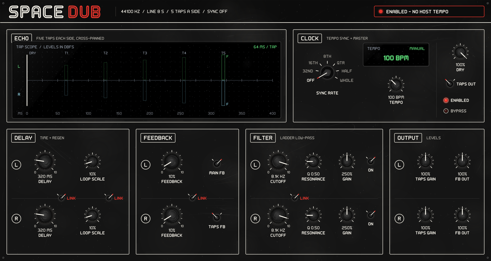

# SpaceDub — VST3 & Audio Unit

A macOS **VST3 and Audio Unit** port of **SpaceDub**, the 2003 Cakewalk DXi
stereo multi-tap delay by A. E. Cobley. The DSP, the parameter set and the control layout are
carried over from the original Visual C++ 6 / MFC project in `../SpaceDub`.

---

## Building

You need **Xcode** (with command line tools) and **CMake 3.25 or newer**.
If you don't have CMake: `brew install cmake`.

```sh
./setup-xcode.sh
open build/SpaceDub.xcodeproj
```

Then pick the **SpaceDub** scheme in Xcode and hit ⌘B.

The first configure clones Steinberg's VST3 SDK (about 250 MB) into
`external/vst3sdk` — that takes a few minutes and needs a network connection.
Every later configure reuses it. If you already have the SDK somewhere:

```sh
cmake -B build -G Xcode -DVST3_SDK_ROOT=/path/to/vst3sdk
```

### Command line instead of Xcode

```sh
cmake -B build -G Xcode
cmake --build build --config Release
```

The built bundle lands in `build/VST3/Release/SpaceDub.vst3`, and CMake also
drops a symlink into `~/Library/Audio/Plug-Ins/VST3/` so your DAW finds it
straight away.

### Turning the validator off

By default Steinberg's `validator` is built and run after every build, which
reports VST3 conformance problems in the build log. It also adds a host
application to the project and a step to every build. To skip it:

```sh
./setup-xcode.sh --no-validator --clean
```

Or, if you are calling CMake yourself:

```sh
cmake -B build -G Xcode -DSMTG_RUN_VST_VALIDATOR=OFF
```

`--minimal` goes one further and also skips `moduleinfo.json`
(`-DSMTG_CREATE_MODULE_INFO=OFF`), which removes the `moduleinfotool` target
as well. That file is only a scanning hint for hosts — the plug-in works
without it — but it is cheap, so prefer `--no-validator` unless you are
chasing build time.

Worth keeping in mind: the validator is the closest thing to a test suite this
project has. It is a good idea to turn it back on before you ship a build, or
run it by hand:

```sh
build/bin/Release/validator build/VST3/Release/SpaceDub.vst3
```

### Audio Unit (.component)

On macOS with the Xcode generator, an **Audio Unit v2** wrapper is built
alongside the VST3, so SpaceDub also loads in Logic, GarageBand and anything
else that only takes AUs. It is Steinberg's wrapper from
`public.sdk/source/vst/auwrapper`: the `.component` bundle contains the VST3
and loads it, so there is no second implementation of the plug-in to keep in
step — one set of sources, one DSP, two plug-in formats.

Building the **SpaceDub-au** scheme produces `build/VST3/<config>/SpaceDub.component`
and copies it to `~/Library/Audio/Plug-Ins/Components/`. Logic rescans on next
launch; to force a rescan, quit Logic and `killall -9 AudioComponentRegistrar`.

Check it the way Apple's own tooling does:

```sh
auval -v aufx SDub AECo
```

That is the AU counterpart of the VST3 validator, and worth running before you
ship — it is stricter about channel layouts and parameter behaviour than most
hosts are.

Two things to know:

* The first configure also clones **Apple's AudioUnitSDK** (small, a few MB)
  into `external/AudioUnitSDK`; Steinberg's wrapper needs it. Skip the whole
  thing with `./setup-xcode.sh --no-au` (or `-DSPACEDUB_BUILD_AU=OFF`). If the
  clone fails the Audio Unit is skipped with a warning — it never breaks the
  VST3 build.
* That SDK is **pinned to AudioUnitSDK-1.1.0**, and the pin matters: Steinberg
  compiles the wrapper as C++17, and AudioUnitSDK 1.3.0 onwards uses
  `std::span` and concepts in its headers. Building those together fails with
  *"no member named 'span' in namespace 'std'"*. If you point
  `-DSPACEDUB_AU_SDK_TAG=` at a newer release, the build raises the C++
  standard on the Audio Unit target for you. A checkout in `external/` left
  over from a different pin is detected and refetched.
* The Audio Unit needs the **Xcode generator**; the SDK only defines the AUv2
  helper there. `--makefiles` gets you the VST3 only.

The plug-in's identity to macOS — the `aufx` / `SDub` / `AECo` four-character
codes — lives in `resource/au-info.plist`. Once you have shipped a build, those
are as fixed as the class UIDs in `SpaceDubIDs.h`: change one and every session
using the plug-in loses it.

### Universal binary

Xcode builds for your own architecture by default. For a fat Intel +
Apple Silicon binary:

```sh
cmake -B build -G Xcode -DSMTG_BUILD_UNIVERSAL_BINARY=ON
```

### Troubleshooting

**`No CMAKE_C_COMPILER could be found`**

CMake cannot find a working compiler. On macOS this is nearly always the
developer-tools selection rather than anything in this project. Check what is
selected:

```sh
xcode-select -p
```

| What it prints | What to do |
|---|---|
| `/Library/Developer/CommandLineTools` | The Xcode generator needs *full* Xcode. Install Xcode from the App Store, then `sudo xcode-select -s /Applications/Xcode.app/Contents/Developer` — or skip Xcode entirely with `./setup-xcode.sh --makefiles` |
| `/Applications/Xcode.app/Contents/Developer` | The licence is probably unaccepted: `sudo xcodebuild -license accept` |
| an error, or nothing | `xcode-select --install` |

Then — and this part matters — **delete the failed cache**. CMake stores the
failure in `build/CMakeCache.txt` and will keep reporting the same error even
after you have fixed the toolchain:

```sh
./setup-xcode.sh --clean
```

`setup-xcode.sh` now checks all of this before it runs CMake and tells you
exactly which case you are in.

**`Apple Development: no identity found`** — you are on a build from before the
signing fix. Reconfigure (`./setup-xcode.sh --clean`); signing now defaults to
ad-hoc and needs no certificate. See **Signing** above.

**Don't have Xcode and don't want it?** `./setup-xcode.sh --makefiles` builds
the plug-in with just the Command Line Tools. You get
`build-make/VST3/SpaceDub.vst3` — a working plug-in, just no `.xcodeproj`.

### Signing

Both bundles are **ad-hoc signed automatically** after every build, which needs
no Apple developer certificate and is enough for macOS to load the plug-in,
including on Apple Silicon. You do not have to do anything.

To sign with a real identity instead — for anything you hand to someone else —
pass it at configure time:

```sh
cmake -B build -G Xcode \
      -DSPACEDUB_CODE_SIGN_IDENTITY="Developer ID Application: Your Name (TEAMID)"
```

`security find-identity -v -p codesigning` lists what you have.

> **Why this is not left to the SDK.** Steinberg defaults
> `SMTG_CODE_SIGN_IDENTITY_MAC` to `"Apple Development"` and its Audio Unit
> post-build step runs `/usr/bin/codesign -s "Apple Development"`
> unconditionally. On a machine with no certificate that fails with
> *"Apple Development: no identity found"* and takes the whole build down after
> everything has already compiled. So unless you supply an identity, the SDK's
> signing is switched off and the bundles are ad-hoc signed by a step in this
> project's `CMakeLists.txt` instead.

---

## What it is

Two independent delay lines (one per channel), each eight seconds long with
five taps. Each line has a Moog-style four-pole ladder filter in its feedback
path, plus two separate regeneration paths: **main feedback**, which folds the
filtered last tap back into the line, and **taps feedback**, which folds each
tap into the one before it. The five taps are panned across the stereo field
in 10 % steps, with tap 5 hard in its own channel — that spreading is what
gives SpaceDub its width.

The delay time can free-run or lock to the host tempo (Off, 32nd … Whole),
and there is a manual tempo for hosts that don't report one.

## The interface



A 1200 × 640 black panel in the style of R2Synth's: matte black, white
printing, boxed sections, black knurled knobs with printed scales, chicken-head
selectors for every switch, small OLED screens, and every letter in a
hand-drawn 70s sci-fi face. Everything is drawn as paths — there is no artwork
in `resource/`. (Until the `Polivoks` branch the window was the original
766 × 499 bitmap panel copied from the Windows dialog; it is in the git
history.)

| Section | What is there |
|---|---|
| **Echo** | the *tap scope*: each channel's five taps on a time axis — left up in green, right down in blue, both centred on the tap's time. Each tap's frame is the share heard on its own side; the fill inside it is **how much signal is going through that tap now** (a meter, −60 … +6 dBFS, the figure printed by the tap's number). The small frame over the other channel's bar is the share that crosses over, with a mark at the level crossing now. Taps that aren't in the output (Taps Out off) are dimmed; **F** marks the tap the filter replaces. **While Taps FB is on**, an amber handle sits over every tap: drag it to set how much that tap feeds back, 0–200 % of Loop Scale (the dim tick is 100 %, the original single amount; double-click returns there). Its value shows top right while you touch it |
| **Clock** | Sync Rate (Off, 32nd … Whole), the tempo screen (the host's tempo when it gives one), the manual Tempo knob (Auto = follow the host), **Dry** — how much of the input is mixed in with the echoes, 0–100 % (the DXi's Straight Thru switch; the DRY line on the tap scope follows it) — Taps Out, and the **Enabled** and **Bypass** lamps |
| **Delay** | Delay and Loop Scale, a row for L over a row for R |
| **Feedback** | Feedback L / R, and the Main FB and Taps FB switches |
| **Filter** | Cutoff, Resonance, Gain and On, L over R |
| **Output** | Taps Gain and FB Out, L over R |

The red **LINK** switches on the line between the L and R rows tie the two
channels together: Delay; Loop Scale (and Taps Gain); Feedback (and FB Out);
the Filter.

Knobs: drag up and down, hold **Shift** for fine adjustment, double-click for
the default; the mouse wheel works too. Selectors: click a position, or click
the knob to step on. Lamps: click to toggle.

Every knob shows its value under it — the delay as the whole echo in
milliseconds (plus the number of sync steps when tempo-locked), the cutoff in
hertz, the rest as percentages. The tap scope quotes one tap's delay.

> **Note** — as in the original, **Enabled** is *off* by default and the
> plug-in passes audio straight through until you press it. The header says so.

## Layout of this project

```
CMakeLists.txt        build definition, fetches the SDK
setup-xcode.sh        one-shot configure helper
source/
  DelayLine.*         the ported DSP (was DelayLine.cpp in the DXi)
  SpaceDubParams.*    parameter table (was Parameters.h + MediaParams)
  SpaceDubProcessor.* audio processing (was CSpaceDubMidi::Process)
  SpaceDubController.*parameter/host plumbing (was CMediaParams)
  SpaceDubEditor.*    the window (was CSpaceDubMidiPropPage)
  SpaceDubLayout.h    the panel's layout, as data
  SpaceDubPanelViews.* knobs, selectors, lamps, screens - all paths
  SciFiLettering.h    the 70s sci-fi lettering (shared with R2Synth)
  PanelWear.h         the panel's dust and scratches (shared with R2Synth)
  SpaceDubEntry.cpp   plug-in factory (was PlugInApp.cpp)
resource/
  au-info.plist       Audio Unit identity (type/subtype/manufacturer codes)
tests/
  DelayLineTests.cpp  standalone DSP checks - no SDK, no host needed
  LayoutTests.cpp     the panel's layout: everything on it, nothing overlaps
tools/
  render-panel/       draws the real editor to doc/plugin-window.png (Linux)
external/
  vst3sdk/            the VST3 SDK (fetched, not in version control)
  AudioUnitSDK/       Apple's AudioUnitSDK, for the AU wrapper (likewise)
```

`PORTING-NOTES.md` records exactly how each DXi parameter, range and DSP quirk
maps onto this version — read it before changing the DSP.

---

Copyright 2026 A. E. Cobley. Licensed under
[CC BY-SA 4.0](https://creativecommons.org/licenses/by-sa/4.0/) — see
[`LICENSE`](LICENSE). Credit it, and share anything you build on it under the
same terms.

The Steinberg VST3 SDK, VSTGUI and Apple's AudioUnitSDK are not covered by
that: they are fetched into `external/` at configure time and carry their own
licence terms.

VST is a trademark of Steinberg Media Technologies GmbH.
